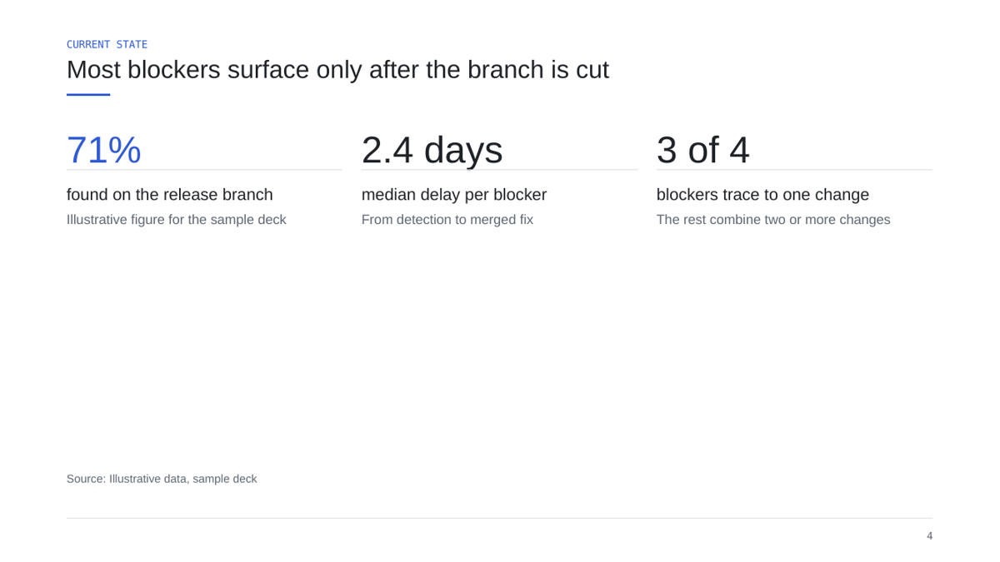
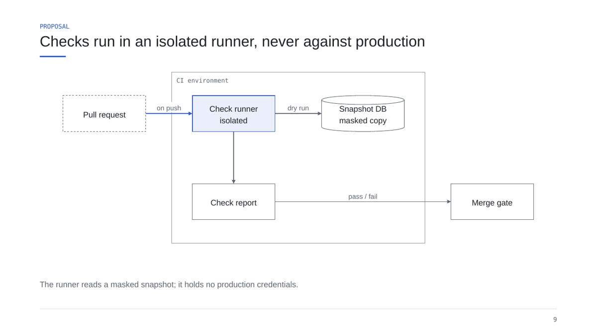
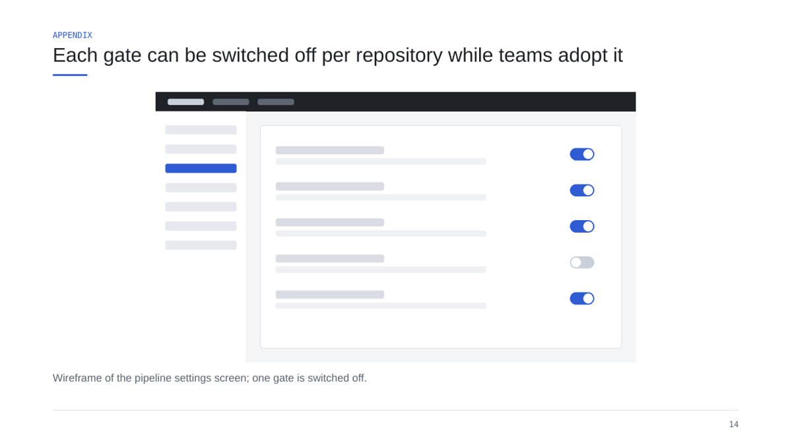
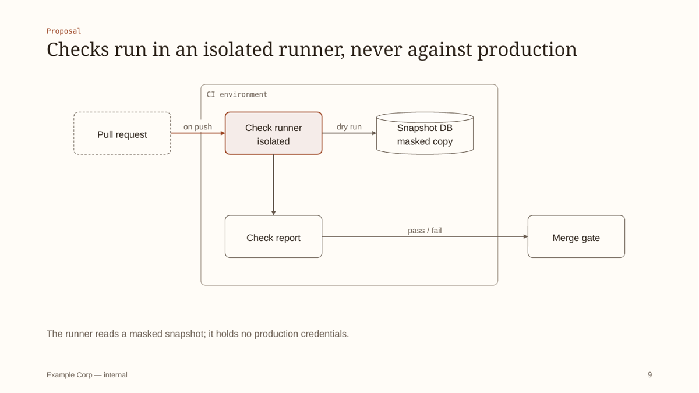

# pptx-deck-skill

[한국어](README.ko.md)

Agent skills that turn a presentation story into a **native, editable
PowerPoint file in your organization's own design**. The model plans the story;
your brand profile decides every color, font, position and slide pattern.

- **`pptx-deck`** — PLAN → BUILD → QA. A plan file (`deck.yaml`) with audience,
  objective and final copy is built into PPTX with python-pptx, rendered to a
  contact sheet and checked.
- **`pptx-layout-audit`** — deck-wide review of alignment, spacing, connectors,
  minimum sizes, contrast and editability for any PPTX.


See [Examples](#examples) for the slides at full size and the PPTX files.

## Why

Generated slides usually look generated: arbitrary colors, bold everything,
cards for every idea, text that overflows. This skill separates the two jobs:

- **Story and craft** live in the skill: conclusion headlines, one message per
  slide, choosing table vs chart vs diagram, density limits, connector
  semantics, writing rules, QA.
- **Design** lives in *your* files: `brand/brand.yaml` (tokens and optional
  company template) and `brand/guidelines.md` (voice, vocabulary, approved
  patterns, exceptions). Swap them and the same deck rebuilds in another brand.

Output is native PowerPoint: real text boxes, native tables and charts with
embedded data, diagrams as shapes with glued connectors, speaker notes on every
slide.

## Examples

All three decks are built by the generator from the specs in
[`skills/pptx-deck/examples/decks/`](skills/pptx-deck/examples/decks) — no hand
editing. Download a PPTX and open it in PowerPoint, Keynote or Google Slides to
check that every element is editable. GitHub cannot preview PPTX, so the images
below are LibreOffice renders of the same files.

### 1. Proposal deck — neutral default brand

[⬇ sample-neutral.pptx](docs/examples/sample-neutral.pptx) · spec:
[`sample.deck.yaml`](skills/pptx-deck/examples/decks/sample.deck.yaml) · 18 slides, every built-in layout

| | |
|---|---|
|  |  |
| `cover` | `stats` — numbers with a source line |
|  |  |
| `chart` — native chart, one highlighted bar, takeaway beside it | `diagram` — native shapes, glued connectors, a boundary |
|  |  |
| `table` — recommended column highlighted | `timeline` |
|  |  |
| `image` — screenshot with caption and alt text | `cards` — one highlighted |

<details>
<summary>All 18 slides</summary>


</details>

### 2. The same deck with another brand profile

[⬇ sample-warm-editorial.pptx](docs/examples/sample-warm-editorial.pptx) · brand:
[`warm-editorial/brand.yaml`](skills/pptx-deck/examples/brands/warm-editorial/brand.yaml)
(about 40 lines: colors, a serif heading font, rounded panels, no headline rule,
a footer label). The spec is unchanged.

| | |
|---|---|
|  |  |
|  |  |

<details>
<summary>All 18 slides</summary>


</details>

### 3. Korean deck with a custom slide

[⬇ ko-sample.pptx](docs/examples/ko-sample.pptx) · spec:
[`ko-sample.deck.yaml`](skills/pptx-deck/examples/decks/ko-sample.deck.yaml) · the
Gantt is a `custom` slide written with deckkit primitives
([`custom/gantt.py`](skills/pptx-deck/examples/decks/custom/gantt.py)).

| | |
|---|---|
|  |  |
|  |  |

Rebuild the examples after changing layouts or brands: `./build-examples.sh`.

## Install

Requirements: Python 3.11+, and for visual QA LibreOffice (`soffice`) and
Poppler (`pdftoppm`).

**As a Claude Code plugin**

```
/plugin marketplace add jeonghun-app/pptx-deck-skill
/plugin install pptx-deck@pptx-deck-skill
```

then install the Python dependencies: `pip install -r requirements.txt`.

**As plain skills** (Claude Code or any agent that reads `SKILL.md` folders)

```
git clone https://github.com/jeonghun-app/pptx-deck-skill
cd pptx-deck-skill && ./install.sh      # links skills into ~/.claude/skills and installs deps
```

## Make it yours

1. **From a company template** (recommended)

   ```
   cd skills/pptx-deck
   python scripts/extract_brand.py ~/company-template.pptx -o brand/brand.yaml --report brand/extract-report.md
   ```

   The template is copied into `brand/assets/` and its layouts are mapped to
   cover / section / content / closing / blank. Decks are then built on its masters, so
   backgrounds, logos and title styles come from the template. Review the report
   — the script cannot know which theme color is your accent.

2. **From scratch** — edit `skills/pptx-deck/brand/brand.yaml`. A partial file
   is fine; missing keys inherit the neutral defaults
   (see `examples/brands/warm-editorial/brand.yaml`).

3. **Write the rules that are not numbers** in `brand/guidelines.md`: voice,
   banned words, required slides, approved patterns, diagram conventions.

4. **Check it**: build the samples with your brand and look at the contact sheet.

   ```
   python scripts/build_deck.py examples/decks/sample.deck.yaml -o out/sample.pptx
   python scripts/render_deck.py out/sample.pptx      # out/sample.render/contact.png
   ```

Precedence: explicit request > company template and `brand.yaml` >
`guidelines.md` > the skill's defaults.

## Use

Ask your agent for a deck ("make a 10-slide proposal for …"). The skill will:

1. ask for source material and what it cannot infer (audience, objective,
   desired action, length);
2. write `<name>.deck.yaml` and stop for your approval;
3. build, lint, render and look at every slide, fix, and report what it checked.

Run the steps yourself:

```
cd skills/pptx-deck
python scripts/lint_deck.py my.deck.yaml
python scripts/build_deck.py my.deck.yaml -o out/my.pptx
python scripts/render_deck.py out/my.pptx
python ../pptx-layout-audit/scripts/deck-craft-lint.py out/my.pptx --brand brand/brand.yaml
```

Layouts: `cover`, `section`, `agenda`, `statement`, `bullets`, `two_column`,
`cards`, `stats`, `table`, `chart`, `process`, `timeline`, `diagram`, `quote`,
`image`, `code`, `closing`, and `custom` (your own Python renderer using the
brand-bound drawing primitives). See
[`references/layouts.md`](skills/pptx-deck/references/layouts.md).

## Repository layout

```
skills/
  pptx-deck/
    SKILL.md              workflow the agent follows
    brand/                YOUR design: brand.yaml, guidelines.md, assets/
    references/           craft: story, writing, visuals, diagrams, data, QA
    scripts/              build_deck, render_deck, lint_deck, extract_brand, find_icon, deckkit/
    examples/             sample decks and an example brand
  pptx-layout-audit/
    SKILL.md, references/, scripts/ (inspect-layout, deck-craft-lint)
docs/                     example PPTX files and their rendered previews (./build-examples.sh)
```

## Tests

```
pip install -r requirements.txt
python -m pytest skills/pptx-deck/scripts/tests
python -B skills/pptx-layout-audit/scripts/test_inspect_layout.py
python -B skills/pptx-layout-audit/scripts/test_deck_craft_lint.py
```

## Notes

- Visual QA renders with LibreOffice, which approximates PowerPoint. Install
  your brand fonts on the render machine and open final files in the
  application your audience uses.
- Use only logos, fonts, icons and images your organization is licensed to
  use. This repository ships none.

## License

MIT
